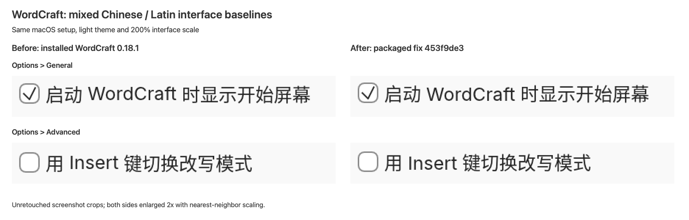

# WordCraft PR screenshot evidence

Visual evidence for [storytold/wordcraft#6415](https://github.com/storytold/wordcraft/pull/6415).

Before: installed WordCraft 0.18.1. After: locally packaged baseline fix at `453f9de35064d62624331415a825e5d4d7e5c5dd`.
Both captures use the same macOS setup, light theme and 200% interface scale. Options > General and Options > Advanced are cropped and enlarged 2x using nearest-neighbor scaling; the captured pixels are otherwise unretouched.

This branch holds screenshot evidence only. Asset attribution is in [ATTRIBUTION.md](ATTRIBUTION.md), with the MIT license in [LICENSE-MIT](LICENSE-MIT).
